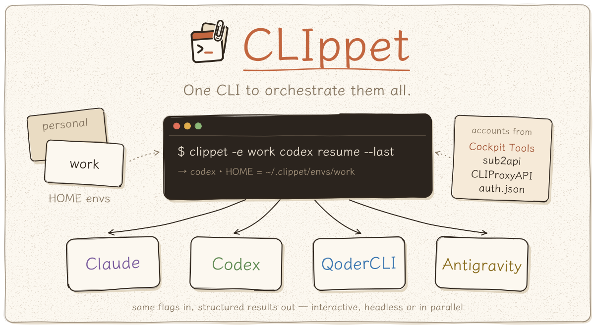
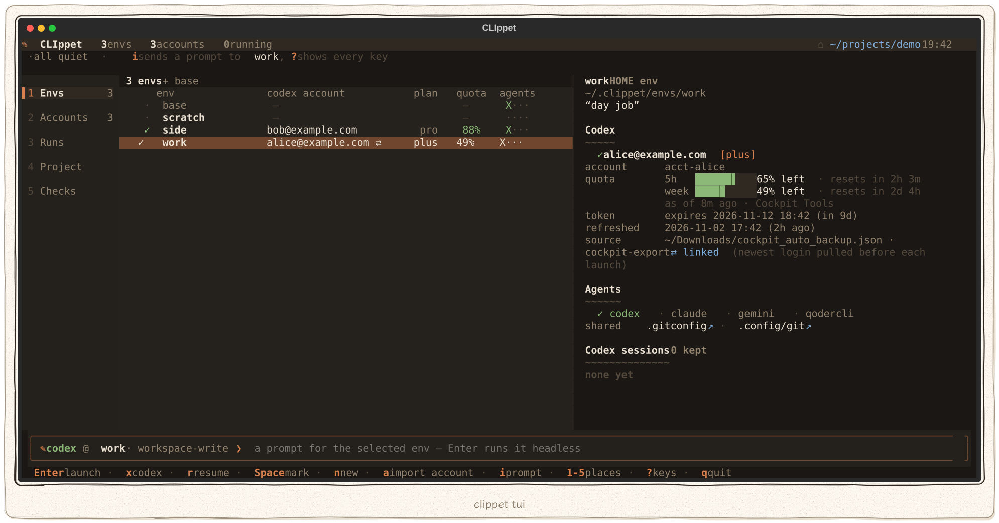
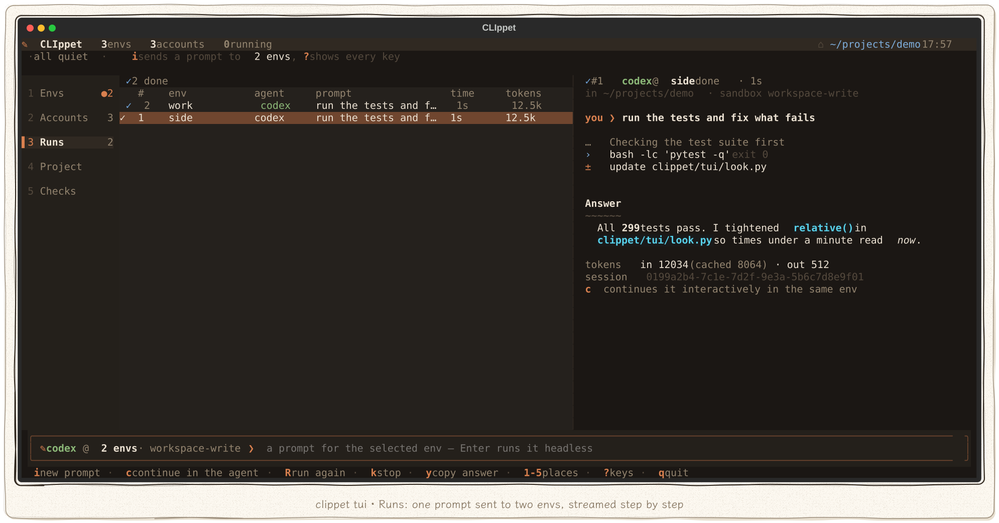
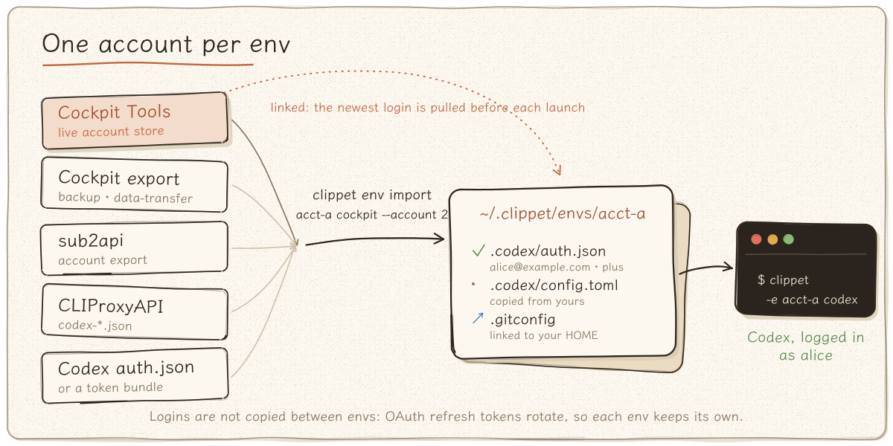
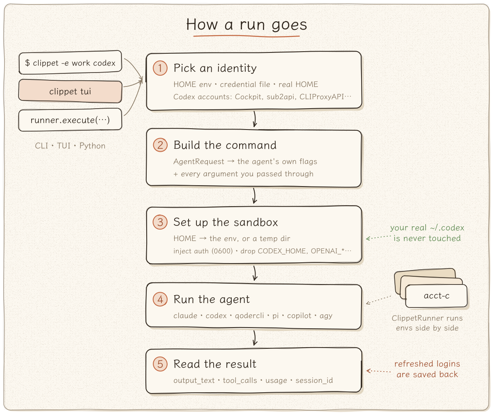
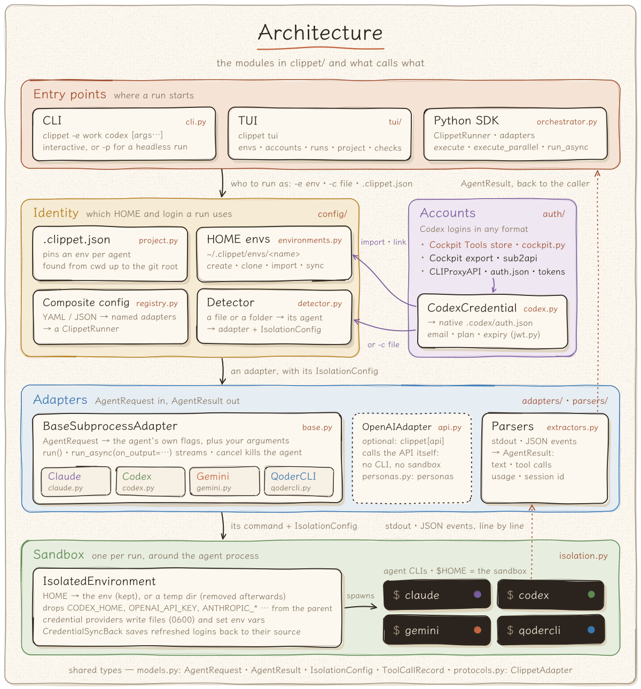

# CLIppet

A unified Python adapter framework for orchestrating heterogeneous CLI AI agents.

CLIppet turns scattered, stateless CLI tools — Codex, Claude Code, Gemini CLI, Qoder CLI, pi, GitHub Copilot CLI and Google Antigravity CLI — into strongly-typed, structured-output Python objects with unified execution, isolation, and credential management.



CLIppet is an **agent execution layer**, not just an account switcher: every run picks an *identity* (a persistent HOME container, a credential file, or your real HOME) per process, so several agents and several accounts can run side by side — from the terminal or from Python.

---

## 1. Quick Start

Point CLIppet at a credential/config file and drop into an interactive session. The agent is inferred from the file format, and the file is injected into a throw-away HOME, so your real config stays untouched.

```bash
clippet -c /path/to/claude-settings.json          # Claude Code (settings.json with env)
clippet -c /path/to/auth.json                     # Codex (auth.json — ChatGPT login or API key)
clippet -c /path/to/auth.json --codex-config cfg.toml   # Codex + its own config.toml
clippet -c /path/to/gemini.env                    # Gemini CLI (.env)
```

Codex accepts credentials in **any common account-manager format** — not only `auth.json`:

```bash
clippet -c cockpit --account 2 codex                       # Cockpit Tools' live account store
clippet -c cockpit_auto_backup_full_2026-11-02.json --account bob@example.com codex
clippet -c sub2api-account-20261102.json codex             # sub2api account export
clippet -c ~/.cli-proxy-api/codex-xxxx-me@example.com-plus.json codex   # CLIProxyAPI
```

Add `-p` to run once headlessly and print the answer:

```bash
clippet -c /path/to/auth.json -p "say hi"
clippet codex -p "Explain the current codebase"
```

Or run plain `clippet` (or `clippet tui`) in a terminal for the [terminal UI](#2-terminal-ui).

Everything after the agent name is **passed through** to the agent's own CLI:

```bash
clippet -e work codex resume --last        # → codex resume --last   (inside env "work")
clippet -e work codex login                # log the env into its own account
clippet -e work claude --continue
clippet -e work codex -c model_reasoning_effort=high
```

---

## 2. Terminal UI

`clippet tui` — or plain `clippet` in a terminal — opens a full-screen UI in the same hand-drawn paper palette as these pictures. It needs the `tui` extra (see [Installation](#7-installation)).



| Place | What it shows | Keys |
|-------|---------------|------|
| **1 Envs** | `base` (your real HOME) and every env: its Codex account, plan, how much of its usage limits is left, linked source, agent dirs and recent Codex sessions | `Enter` launch an agent: who it runs as, its HOME and folder are shown first, add arguments if you like and `Enter` again (`Tab` picks another agent) · `x` Codex right away, no questions · `r` / `s` resume the newest Codex session / pick one, again showing which conversation, as whom and in which folder first · `Space` mark · `n` / `c` / `d` new, clone, remove · `a` import an account · `y` sync a linked login |
| **2 Accounts** | every Codex account in Cockpit Tools and in the files you add (exports, sub2api, CLIProxyAPI, `auth.json`), how much of its limits is left, and which env holds it | `Enter` put it into an env · `x` export `auth.json` · `+` / `-` add or forget a file |
| **3 Runs** | the prompts you sent, streamed: commands, edits, tool calls, the answer, tokens | `c` continue the run's conversation in the agent (shown first, like a launch) · `R` run again · `k` stop · `y` copy the answer |
| **4 Project** | the workspace and its `.clippet.json`: what each agent resolves to | `p` pin an agent to an env · `w` workspace · `e` edit |
| **5 Checks** | agent CLIs and versions, CLIppet's paths, Cockpit Tools access, the variables isolation drops, env health | `Ctrl+R` check again |

Drag the line between two panes to give the one on its left more or less room; a double click puts it back. The widths are kept in `~/.clippet/tui.json` with the theme.

The lists in Envs, Accounts and Runs can be arranged too. Click a header to sort by that column; click it again for the reverse, and a third time for the original order. `/` keeps only the rows that contain every word you type (`Esc` clears it). Drag the gap between two headers to make a column narrower or wider; a double click puts it back. The sort and the column widths are remembered with the rest.

The quota bars show what is left of each limit window (the 5-hour one, the weekly one) and when it starts over. CLIppet does not ask OpenAI for them: it shows the newest of the readings Cockpit Tools keeps from its own usage checks and the ones Codex writes into an env's session logs after every turn.

The box at the bottom (`i`) sends a prompt headless — `codex exec --json` for Codex — to the selected env, or to every env marked with `Space`, in parallel. In the box `Tab` switches the agent and `Ctrl+B` the Codex sandbox. Launching an agent hands it the terminal and CLIppet comes back when it exits; a linked login is pulled first, exactly as with `clippet -e NAME AGENT`.



`T` switches between ink (dark) and paper (light) and `?` lists every key. The theme, the agent and the account files you added are kept in `~/.clippet/tui.json`.

---

## 3. Accounts & Environments

### 3.1 HOME containers (conda-style envs)

A HOME env is a persistent fake `$HOME` at `~/.clippet/envs/<name>/`. CLIppet launches the agent with that directory **as** `$HOME`, so its login, sessions, MCP state and history persist across runs — and stay separate from every other env. Two envs can run at the same time with two different accounts.

```bash
clippet env create work --from-current     # copy your agent *configuration* (no logins)
clippet -e work codex login                # log in once inside the env
clippet -e work codex                      # from now on: always this account
clippet -e personal codex                  # meanwhile, in a second terminal: a second account
```

What `--from-current` copies — and what it deliberately does not:

| Copied (configuration) | Not copied |
|------------------------|------------|
| `~/.codex/config.toml`, `AGENTS.md`, `skills/`, `prompts/`, `rules/`, `hooks.json` | sessions, history, logs, sqlite DBs, caches, sockets |
| `~/.claude/settings.json`, `CLAUDE.md`, `agents/`, `commands/`, `skills/`, `~/.claude.json` (MCP; account keys stripped) | `~/.claude/projects` transcripts |
| `~/.gemini/settings.json`, `GEMINI.md`, `commands/`, `extensions/` | |
| `~/.qoder/settings.json`, `AGENTS.md`, `rules/`, `commands/`, `agents/`, `skills/`, `hooks/` … | `~/.qoder/projects` sessions, caches |
| `~/.pi/agent/settings.json`, `mcp.json`, `AGENTS.md`, `extensions/`, `skills/`, `prompts/`, `themes/` | pi sessions, its managed install |
| `~/.copilot/settings.json`, `copilot-instructions.md`, `agents/`, `skills/`, `mcp-config.json` … | Copilot session state, logs |
| `~/.gemini/antigravity-cli/settings.json`, `keybindings.json`, `skills/`, `~/.gemini/config` | Antigravity conversations |
| **Credentials only with `--with-auth`**: `.codex/auth.json`, `.claude/.credentials.json`, `.gemini/.env`, `oauth_creds.json`, `.qoder/.auth/` and BYOK `.qoder/.models/`, `.pi/agent/auth.json` and `models.json`, `.copilot/config.json` and `providers.json`, Antigravity's token file | |

Settings files can carry a login too; without `--with-auth` those keys are left out and listed: `apiKeyHelper` and the `ANTHROPIC_*` / `AWS_*` entries of the `env` block in Claude's `settings.json` (a third-party endpoint goes with its key), the account keys of `~/.claude.json`, Qoder's BYOK `modelConfigs.customModels`, Antigravity's `modelProvider` (it would refuse to start without the key it names), pi's device id.

> **Why logins are not copied by default** — OpenAI (and Anthropic) rotate OAuth refresh tokens: the first copy that refreshes invalidates every other copy, and reusing an old refresh token can revoke the whole login. For parallel long-term use, log in separately inside each env. `--with-auth` is there when you knowingly want a copy.

New envs also **link** (not copy) `~/.gitconfig` and `~/.config/git` from your real HOME, so `git commit` inside an agent session keeps your identity. Change this with `--share PATH` (repeatable) or `--no-share`.

```bash
clippet env list                     # envs with the Codex account each one carries
clippet env status [name]            # detailed identity: account, plan, token expiry, source
clippet env path work                # print the HOME path
clippet env clone work scratch       # duplicate (sessions included; logins, endpoints and their keys only with --with-auth)
clippet env remove scratch           # unregister, keep the directory
clippet env remove scratch --purge   # also delete ~/.clippet/envs/scratch/
```

Running bare `clippet codex` (or `claude` / `gemini` / `qodercli` / `pi` / `copilot` / `agy`) in a terminal opens a small picker listing `base` (your real HOME) and every env, with the Codex account of each.

### 3.2 Importing Codex accounts from other tools

`clippet env import` stores one account from any supported source in an env (creating it, with your Codex config but no other logins, if needed):

```bash
clippet auth list cockpit                         # what does Cockpit Tools hold?
clippet env import acct-a cockpit --account 2     # linked to Cockpit (default for 'cockpit')
clippet env import acct-b ./backup.json --account bob@example.com
clippet -e acct-a codex                           # → Codex logged in as that account
```



Supported Codex credential sources:

| Source | How to pass it | Notes |
|--------|----------------|-------|
| Codex `auth.json` | path to the file, a HOME dir, or a `CODEX_HOME` dir | ChatGPT login, API key, PAT / agent-identity files are passed through verbatim |
| Cockpit Tools live store | `cockpit`, `cockpit:<dir>`, or the data dir (`~/.antigravity_cockpit`) | read-only; decrypting needs the `cockpit` extra |
| Cockpit Tools export / auto-backup | `cockpit-tools.data-transfer` / `account-transfer` JSON | only the Codex platform is read |
| sub2api account export | `sub2api-account-*.json` | only `platform: openai` accounts; Claude/Gemini entries are ignored |
| CLIProxyAPI token file | `codex-*.json` (`"type": "codex"`) | the separate `siwc` token set is never used |
| Token bundle | `{"id_token", "access_token", "refresh_token"}` (also nested in `tokens` / `credentials`) | the access token must be an OpenAI JWT |
| JSON arrays / JSON Lines | of any of the above | |

Select one account with `--account`: a 1-based index from `clippet auth list`, an e-mail, the e-mail's local part, a label or an account id. Accounts the source marks as needing re-login, ChatGPT web-session tokens and non-OpenAI tokens are flagged or skipped.

**Linked envs** (`--link`, the default for the Cockpit store) pull the newest login from the source before every launch, so the account manager stays the one that refreshes tokens. If Codex ever refreshes inside the env first, CLIppet keeps the env's newer login and warns you that the source now holds a superseded refresh token. `clippet env sync <name>` pulls on demand.

Other conversions:

```bash
clippet auth export cockpit --account 2 -o ./acct2-auth.json   # native auth.json (0600)
```

**Temporary runs** (`-c <source>`) convert the credential into a throw-away HOME. If Codex refreshes the tokens during the run, the new login is not lost: for native `auth.json` sources it is written back to that file; for converted sources it is saved under `~/.clippet/refreshed/` and CLIppet tells you where.

Using a **sub2api (or any OpenAI-compatible) gateway key** works with the regular two-file mode:

```bash
echo '{"OPENAI_API_KEY": "<gateway key>"}' > gw-auth.json
cat > gw.toml <<'EOF'
model_provider = "OpenAI"
model = "gpt-5.5"
[model_providers.OpenAI]
name = "OpenAI"
base_url = "https://<gateway host>/v1"
wire_api = "responses"
requires_openai_auth = true
EOF
clippet -c gw-auth.json --codex-config gw.toml codex
```

### 3.3 Passing arguments through

```
clippet [CLIPPET OPTIONS] [AGENT] [AGENT ARGS...]
```

- CLIppet options (`-c`, `-e`, `--account`, `--codex-config`, `-p`) go **before** the agent name.
- Everything after the agent name goes to the agent CLI unchanged, including subcommands (`resume`, `login`, `mcp`, ...) and the agent's own `-c`.
- One exception keeps `clippet codex -p "task"` working: a `-p/--prompt` *directly* after the agent name is CLIppet's headless prompt. Use `--` to forward even that: `clippet -e work claude -- -p "hi" --output-format stream-json`.
- With pass-through arguments CLIppet never reads stdin, so `clippet -e work codex login --with-api-key < key.txt` works.
- In headless mode (`-p`) the extra arguments are added to the agent's headless command (e.g. `codex exec`).

Interactive launches only add the flags you configured — CLIppet does not inject a model, sandbox or permission mode of its own.

### 3.4 How isolation works (and its limits)

- `$HOME` points at the env (or a temp dir). Variables that would redirect an agent elsewhere are removed from the inherited environment: for example `CODEX_HOME`, `OPENAI_API_KEY` (Codex), `ANTHROPIC_*`, `CLAUDE_CONFIG_DIR`, `CLAUDE_CODE_OAUTH_TOKEN` (Claude), `GEMINI_API_KEY`, `GOOGLE_*` credentials (Gemini, Antigravity), `GH_TOKEN`, `COPILOT_PROVIDER_*` (Copilot), `QODER_*` tokens (Qoder), the provider keys pi reads, and `XDG_CONFIG_HOME` / `XDG_DATA_HOME` / `XDG_STATE_HOME` / `XDG_CACHE_HOME`; the full lists are in `clippet/agents.py`. Values from your credential file, the env's own variables (§3.6) or `env_overrides` are applied afterwards. Opt out in Python with `IsolationConfig(scrub_agent_env=False)`.
- In an env (not in your real HOME) Claude Code and Antigravity CLI run with their self-updaters off, so no env downloads its own copy of the binary. pi's own Node.js and Copilot CLI's unpacked package are linked into envs from your real HOME instead of being installed per env.
- Some agents keep their login in the OS keychain, which a `$HOME` does not separate. On macOS they look for the login keychain under `$HOME` and find none under an env's: Copilot CLI and Antigravity CLI then keep the login in a file inside the env (Copilot asks first: answer `y`), and Claude Code may do the same (not verified with a real Claude account). If macOS says a keychain cannot be found, choose **Cancel**, never "Reset To Defaults". On Linux desktops and Windows the envs share one keyring for those agents. Qoder CLI and pi keep their logins in files.
- When CLIppet injects a Codex `auth.json`, it also passes `-c cli_auth_credentials_store="file"` so a `config.toml` that selects the OS keyring cannot hide it.
- This is HOME/environment isolation, not a security sandbox: the agent can still read files outside its workspace, and credential stores keyed by absolute paths (e.g. the macOS Keychain) are only as separate as the tool makes them.
- `CLIPPET_HOME` relocates `~/.clippet` (registry and envs).

### 3.5 File-alias envs (legacy)

A short name for an existing config file. CLIppet copies that one file into a fresh temp HOME on each run — no session persistence, suitable for one-shot scripted calls.

```bash
clippet env add mycodex /path/to/auth.json
clippet -e mycodex -p "say hi"
```

### 3.6 Third-party APIs (relays, compatible providers, local models)

Every agent can be pointed at an API other than its maker's; CLIppet does it per env and per agent, in the agent's own way:

```bash
export RELAY_KEY=...                     # e.g. in ~/.secrets.zsh; CLIppet stores only the name
clippet env create relay
clippet env endpoint relay claude  https://relay.example.com/anthropic --key-env RELAY_KEY --model kimi-k2
clippet env endpoint relay codex   https://relay.example.com/v1 --key-env RELAY_KEY --model gpt-5.5
clippet env endpoint relay pi      http://127.0.0.1:11434/v1 --model qwen3:8b          # no key: a local server
clippet env endpoint relay copilot https://relay.example.com/v1 --api openai-responses --key-env RELAY_KEY --model gpt-5.5
clippet env endpoint relay agy     https://gemini-proxy.example.com --key-env GEMINI_KEY
clippet env endpoint relay           # what each agent in the env uses
clippet env endpoint relay claude --clear
```

| Agent | How CLIppet points it at the endpoint | API styles |
|-------|---------------------------------------|------------|
| Claude Code | `ANTHROPIC_BASE_URL`, `ANTHROPIC_AUTH_TOKEN`, `ANTHROPIC_MODEL` | Anthropic Messages |
| Codex | `config.toml`: `model_provider = "clippet"` and `[model_providers.clippet]` (`base_url`, `env_key`) | Responses |
| Gemini CLI | `GOOGLE_GEMINI_BASE_URL`, `GEMINI_API_KEY`, `GEMINI_MODEL` | Gemini |
| Antigravity CLI | `GOOGLE_GEMINI_BASE_URL`, `GEMINI_API_KEY`, and `modelProvider: "gemini"` in its `settings.json` | Gemini |
| Copilot CLI | `COPILOT_PROVIDER_BASE_URL`, `COPILOT_PROVIDER_TYPE` (+ `WIRE_API`), `COPILOT_PROVIDER_API_KEY`, `COPILOT_MODEL` | OpenAI, OpenAI Responses, Anthropic, Azure |
| pi | `models.json`: provider `clippet` (`baseUrl`, `api`, `apiKey`), made the default in `settings.json` | OpenAI, OpenAI Responses, Anthropic, Gemini |
| Qoder CLI | only its own `/model` → Custom tab (BYOK with a custom URL); run it in the env and add one there | — |

- **Keys stay out of files.** `--key-env VAR` stores `${VAR}`; CLIppet reads `$VAR` from its own environment at each launch and stops with a clear message when it is unset. `clippet env vars ENV AGENT 'NAME=${VAR}'` sets any other variable the same way (quote it so the shell does not expand it), e.g. Claude Code's `ANTHROPIC_DEFAULT_SONNET_MODEL`; `--unset NAME` removes one.
- These variables are applied **after** CLIppet drops the inherited ones that would change an agent's identity, so an env never runs on the parent shell's key by accident. In `base` (your real HOME) nothing is dropped: the variables of your shell apply as they are.
- An endpoint the agent itself names is honored too: an `env` block in the env's `.claude/settings.json`, Codex's `openai_base_url` (written when you `clippet env import` an API-key credential with a base URL), a `providers.json` for Copilot, a `.gemini/.env`. The TUI shows each agent's endpoint, model and key source in the env detail and before every launch.
- Single-file mode keeps working for one-off runs: `clippet -c claude-settings.json` with an `env` block, a Codex API-key credential with a base URL, or a Gemini `.env`.

### 3.7 The Codex app, one instance per env (macOS)

```bash
clippet -e work codex app ~/repos/project    # the Codex desktop app as env "work"
clippet -e personal codex app                 # at the same time: a second instance, another account
```

In the TUI, `g` opens it as the selected env, or as every marked env.

Each instance keeps Codex's state in the env's `.codex` (`CODEX_HOME`: login, config, sessions) and Electron's in the env's `.codex-desktop` (`CODEX_ELECTRON_USER_DATA_PATH` and `--user-data-dir`); the app you start from the Dock keeps using `~/.codex`. CLIppet starts it with `open -n`, the way the app starts separate instances of itself: an internal mechanism, not a documented interface (see `docs/codex-desktop-multi-account-research.md`).

- CLIppet writes `cli_auth_credentials_store = "file"` into the env's `config.toml`, so a login made in that instance lands in the env's `auth.json`.
- An env whose instance is already open is brought to the front instead of getting a second process on the same folders. While it is open, no CLIppet launch pulls a linked env's newest login into it.
- The app must pass `codesign --verify --deep --strict` and be signed by OpenAI (team `2DC432GLL2`), as `codex app` requires; `CLIPPET_CODEX_APP_UNVERIFIED=1` opens it anyway. CLIppet finds it by its bundle id (`com.openai.codex`, installed as Codex.app or ChatGPT.app); `CLIPPET_CODEX_APP` points at another copy.
- The app reads your login shell's variables itself, so the key of an endpoint (§3.6) must be exported there (for example in `~/.secrets.zsh`).
- Not yet verified end to end with two real ChatGPT accounts in two windows. macOS only.

---

## 4. Project-level `.clippet.json`

Run `clippet codex` / `claude` / `gemini` / `qodercli` inside a project without passing `-c` every time. A project can either pin a **named env** (so it always runs under the right account) or reference credential files:

```json
{
  "version": 1,
  "agents": {
    "codex":    { "env": "work" },
    "claude":   { "config_path": ".clippet.local/claude-settings.json" },
    "gemini":   { "config_path": ".clippet.local/gemini.env" },
    "qodercli": { "env": "work" }
  }
}
```

Codex can also use files, including multi-account sources:

```json
{
  "version": 1,
  "agents": {
    "codex": {
      "config_path": ".clippet.local/codex-auth.json",
      "codex_config_path": ".clippet.local/codex-config.toml",
      "account": "work@example.com"
    }
  }
}
```

**Security rules:**

- `.clippet.json` stores only **references** (env names, file paths), never API keys or tokens — unknown fields are rejected.
- `.clippet.local/` must be gitignored because it may contain machine-specific credentials.
- Relative paths must stay inside the project root. Use absolute paths (or `~`-expanded paths like `~/.codex/auth.json`) to reference files outside the project.
- Discovery stops at the nearest Git root — CLIppet will not pick up `.clippet.json` files from unrelated parent directories.
- `env` and file paths are mutually exclusive per agent.

**Path resolution:**

| Path style | Behavior |
|------------|----------|
| `.clippet.local/auth.json` | Relative to project root (where `.clippet.json` lives) |
| `~/.codex/auth.json` | Expanded to user home directory |
| `/absolute/path/to/auth.json` | Used as-is |
| `cockpit` / `cockpit:<dir>` | The Cockpit Tools account store |
| `../escape.json` | **Rejected** — use absolute path instead |

**Precedence:** explicit flags always override project-level config:

```bash
clippet -c /explicit/auth.json codex   # Uses explicit path, ignores .clippet.json
clippet codex                          # Uses .clippet.json
```

---

## 5. Why CLIppet?

CLI AI agents are powerful but painful to integrate programmatically:

- **No standard interface** — each tool has its own flags, output formats, and execution models
- **Black-box outputs** — extracting tool calls or intermediate state requires fragile regex or LLM-based post-processing
- **No isolation** — running multiple agents concurrently with different credentials is error-prone
- **No orchestration** — coordinating parallel agent execution requires custom boilerplate every time

CLIppet solves all of this with a single `adapter.run(request)` call — and the identity of every run is explicit.

---

## 6. Features

- **Unified Protocol** — consistent `run()` / `run_async()` interface across all adapters
- **Structured Output** — final answer, tool calls, step count, token usage, cost and session id from each agent's own JSON events (Codex `exec --json`, Claude Code and Qoder CLI `stream-json`, pi `--mode json`, Copilot CLI and Antigravity CLI JSON output)
- **Identity layer** — persistent HOME envs, multi-format Codex credentials (Codex, Cockpit Tools, sub2api, CLIProxyAPI), linked imports, refreshed-token write-back
- **Sandbox Isolation** — per-run credential injection, identity env-var scrubbing, temporary workspaces
- **Parallel Orchestration** — `ClippetRunner` dispatches multiple agents concurrently via thread pool or asyncio
- **Terminal UI** — `clippet tui`: envs, accounts, streamed runs (one prompt in many envs), project pins and checks
- **Live output** — `run_async(request, on_output=...)` streams each line while the agent works; the TUI turns every agent's events into steps as they arrive
- **Third-party APIs** — per env and per agent, `clippet env endpoint` points any agent at a relay, a compatible provider or a local server; keys stay in your shell
- **Declarative Config** — YAML/JSON-based adapter registration with credential profiles; per-project `.clippet.json`
- **Built-in Adapters** — Codex, Claude Code, Gemini CLI, Qoder CLI, pi, GitHub Copilot CLI and Google Antigravity CLI out of the box; extensible via `BaseSubprocessAdapter` and one entry in `clippet/agents.py`

---

## 7. Installation

CLIppet is not on PyPI yet, so install it from GitHub:

```bash
pip install "clippet @ git+https://github.com/FanBB2333/CLIppet.git"
pip install "clippet[tui,cockpit] @ git+https://github.com/FanBB2333/CLIppet.git"   # with extras
```

The extras are `cockpit` (reading the Cockpit Tools account store), `tui` (the terminal UI, `clippet tui`) and `api` (`OpenAIAdapter`). For development, see [Development](#15-development).

> Requires Python 3.10+

---

## 8. Python SDK Quick Start

```python
from clippet import ClippetRunner, AgentRequest
from clippet.adapters import CodexAdapter

runner = ClippetRunner(max_workers=4)
runner.register("codex", CodexAdapter(sandbox="workspace-write"))

request = AgentRequest(
    task_prompt="Find and fix the bug in src/server.py",
    workspace_dir="/path/to/project",
    timeout=900,
)

result = runner.execute("codex", request)

print(f"Success: {result.is_success} in {result.execution_time:.1f}s")
print(f"Answer:  {result.output_text}")
print(f"Tools:   {[t.tool_name for t in result.tool_calls]}")
print(f"Usage:   {result.usage}")          # e.g. {'input_tokens': ..., 'output_tokens': ...}
print(f"Thread:  {result.session_id}")
```

Adapters only pass the options you set; with no `model` the agent uses the model configured in its HOME.

To watch a run while it works, pass `on_output` to `run_async`; it gets every stdout line as it arrives — for Codex, one `exec --json` event per line. Cancelling the task stops the agent (and still saves a login it refreshed):

```python
import asyncio, json

def show(line: str) -> None:
    event = json.loads(line)
    if event.get("type") == "item.completed":
        print("·", event["item"]["type"])

result = asyncio.run(CodexAdapter().run_async(request, on_output=show))
```

---

## 9. Advanced CLI Usage

### 9.1 CLIppet composite config (advanced)

When you need multiple adapters with shared credential profiles, use a CLIppet YAML/JSON config file:

```bash
clippet -c single-adapter-config.json
clippet -c clippet-config.json codex-default -p "review the current repository"
```

Rules:

- If the composite config has exactly one adapter, CLIppet selects it automatically.
- If the composite config has multiple adapters, pass the adapter `name` from the config file.
- Second-home directory mode still requires an explicit agent (`claude`, `codex`, `gemini`, `qodercli`).

See the [Configuration](#12-configuration-yaml-or-json) section for the full schema.

### 9.2 Behavior summary

| Flag | Meaning |
|------|---------|
| `-c <file>` | Claude settings JSON, Codex credential (any supported format), Gemini `.env`, CLIppet composite config, a HOME directory, or `cockpit` |
| `--codex-config <file>` | Codex `config.toml` (model / provider). Can be combined with `-c` or used alone |
| `--account <sel>` | Pick one account from a multi-account credential source |
| `-e <name>` | A saved environment — a HOME container (default) or a file alias (legacy) |
| `-p <prompt>` | Run once non-interactively; omit to launch an interactive session |
| `[agent]` | Native agent type or composite adapter name. Native configs and single-adapter composite configs can omit it |
| `[agent args...]` | Passed through to the agent CLI (see 3.3) |

---

## 10. Parallel Execution

Run multiple agents — or the same agent under several accounts — simultaneously:

```python
from clippet import ClippetRunner, AgentRequest, get_environment
from clippet.config.detector import create_adapter_with_second_home

runner = ClippetRunner(max_workers=2)
for env in ("acct-a", "acct-b"):          # two HOME envs, two Codex accounts
    home = get_environment(env)["home_dir"]
    runner.register(env, create_adapter_with_second_home(home, "codex"))

request = AgentRequest(task_prompt="Refactor the auth module", workspace_dir="/path/to/project")
results = runner.execute_parallel({"acct-a": request, "acct-b": request})

for name, result in results.items():
    print(f"{name}: {'pass' if result.is_success else 'fail'} in {result.execution_time:.1f}s")
```

---

## 11. Credential Isolation

Run agents with different API keys without conflicts:

```python
from clippet import AgentRequest, IsolationConfig

request_a = AgentRequest(
    task_prompt="Fix the login bug",
    workspace_dir="/path/to/project",
    isolation=IsolationConfig(
        env_overrides={"ANTHROPIC_API_KEY": "sk-key-A"},
    ),
)

request_b = AgentRequest(
    task_prompt="Fix the login bug",
    workspace_dir="/path/to/project",
    isolation=IsolationConfig(
        env_overrides={"ANTHROPIC_API_KEY": "sk-key-B"},
    ),
)

results = runner.execute_parallel({
    "agent-a": request_a,
    "agent-b": request_b,
})
```

`IsolationConfig` also accepts `credential_files` (copy files into the sandbox HOME), `credential_contents` (write generated files), `home_dir` (use a persistent HOME), `sync_back` (copy rewritten credential files back after the run) and `env_whitelist` / `env_blacklist`.

---

## 12. Configuration (YAML or JSON)

Define adapters and credential profiles declaratively:

```json
{
    "credential_profiles": {
        "personal": {
            "files": {
                ".claude/settings.json": "~/profiles/personal/settings.json"
            },
            "env": {
                "ANTHROPIC_API_KEY": "${PERSONAL_API_KEY}"
            }
        }
    },
    "adapters": [
        {
            "adapter_type": "claude",
            "name": "claude-personal",
            "options": {
                "model": "opus",
                "credential_profile": "personal"
            }
        },
        {
            "adapter_type": "codex",
            "name": "codex-default",
            "options": {
                "sandbox": "workspace-write"
            }
        },
        {
            "adapter_type": "qodercli",
            "name": "qodercli-default",
            "options": {
                "model": "auto"
            }
        },
        {
            "adapter_type": "gemini",
            "name": "gemini-default",
            "options": {
                "model": "gemini-3.1-pro"
            }
        }
    ],
    "default_timeout": 900,
    "max_workers": 4
}
```

```python
from clippet.config import load_config, create_runner_from_config

config = load_config("clippet-config.json")
runner = create_runner_from_config(config)

result = runner.execute("claude-personal", request)
```

---

## 13. How It Works



- **Identity layer** decides which HOME and credentials a run uses: a HOME env, a credential file in any supported format (converted to the agent's native layout), or the real HOME.
- **Adapter layer** translates a generic `AgentRequest` into tool-specific CLI flags and parses the raw output back into a structured `AgentResult`.
- **Sandbox** sets `$HOME`, injects credential files and env vars, removes identity variables inherited from the parent, and cleans up temp HOMEs — after syncing refreshed logins back.
- **ClippetRunner** wraps multiple adapters and dispatches them in parallel via a thread pool or asyncio.

---

## 14. Architecture



A run goes down the left of the picture and its result comes back up the right:

- **Entry points**: the CLI, the TUI and the Python SDK; all three drive the same layers below.
- **Identity** (`config/`): decides who the run is: a HOME env (`-e`), a credential file (`-c`), a `.clippet.json` pin, or a composite config. It builds the adapter, and that adapter carries the run's `IsolationConfig`.
- **Accounts** (`auth/`): reads Codex logins from Cockpit Tools, sub2api, CLIProxyAPI or `auth.json` into one `CodexCredential`. These are imported or linked into envs, or used directly with `-c`.
- **Adapters** (`adapters/`, `parsers/`): turn the `AgentRequest` and your passed-through arguments into the agent's own command, then turn its stdout or JSON events back into an `AgentResult`.
- **Sandbox** (`isolation.py`): points `$HOME` at the env or a temp dir, drops inherited identity variables, writes credentials (0600), and saves refreshed logins back when the agent exits.

```
clippet/
├── cli.py               # The clippet command: run, env, auth, tui
├── __init__.py          # Public API
├── orchestrator.py      # ClippetRunner (parallel dispatch)
├── tui/                 # clippet tui (Textual)
│   ├── app.py           # masthead, ribbon, places, prompt box, one animation clock
│   ├── views/           # Envs, Accounts, Runs, Project, Checks
│   ├── data.py          # what the places show, read from CLIppet's own state
│   ├── runs.py          # streamed headless runs, interactive launches
│   ├── widgets.py       # tables, panes and dialogs the places share
│   ├── look.py          # paper palettes and the hand-drawn mark in braille
│   └── anim.py          # star frames, gleam, breathe, tweens
├── config/
│   ├── project.py       # .clippet.json discovery
│   ├── environments.py  # HOME envs, seeding, Codex account import/sync
│   ├── registry.py      # YAML/JSON config & adapter registration
│   └── detector.py      # Config/credential detection and adapter factories
├── auth/
│   ├── codex.py         # Codex credentials in every format → native auth.json
│   ├── cockpit.py       # Cockpit Tools account store (read-only)
│   └── jwt.py           # Local JWT claim decoding
├── adapters/
│   ├── base.py          # BaseSubprocessAdapter: command, run/run_async, streaming, cancel
│   ├── claude.py        # Claude Code CLI adapter
│   ├── codex.py         # Codex CLI adapter (+ exec --json event parser)
│   ├── gemini.py        # Gemini CLI adapter
│   ├── qodercli.py      # Qoder CLI adapter (stream-json, as Claude Code's)
│   ├── pi.py            # pi adapter (--mode json)
│   ├── copilot.py       # GitHub Copilot CLI adapter (--output-format json)
│   ├── antigravity.py   # Google Antigravity CLI adapter (stream-json)
│   ├── api.py           # OpenAIAdapter: calls the API directly (optional, clippet[api])
│   └── personas.py      # Persona prompts and skill blocks
├── parsers/
│   └── extractors.py    # JSON/text output parsers
├── agents.py            # What differs between the agent CLIs: files, logins, variables, resume, endpoints
├── endpoints.py         # Third-party API endpoints per env and agent
├── desktop.py           # The Codex desktop app, one instance per env (macOS)
├── isolation.py         # Sandbox environments, credential providers, env scrubbing
├── models.py            # AgentRequest, AgentResult, IsolationConfig, ToolCallRecord
└── protocols.py         # ClippetAdapter protocol
```

### 14.1 Core Data Models

| Model | Purpose |
|-------|---------|
| `AgentRequest` | Task prompt, workspace, timeout, model override, extra CLI args, isolation config |
| `AgentResult` | Raw output, final `output_text`, success flag, execution time, tool calls, step count, usage, session id |
| `ToolCallRecord` | Tool name, parameters, timestamp |
| `IsolationConfig` | HOME dir, credential files/contents, sync-back, env overrides, whitelist/blacklist, env scrubbing |
| `CodexCredential` | One Codex identity from any source format; renders native `auth.json` |

### 14.2 Built-in Adapters

| Adapter | CLI Tool | Key Flags |
|---------|----------|-----------|
| `ClaudeAdapter` | `claude -p --output-format json` (or `stream-json`) | `--model`, `--permission-mode`, `--max-turns`, `--allowed-tools` |
| `CodexAdapter` | `codex exec --json` | `--model`, `--sandbox`, `--cd`, `--add-dir`, `--skip-git-repo-check`, `-c` |
| `QoderCLIAdapter` | `qodercli -p … -o stream-json` | `--model`, `--max-turns`, `-w`, `--permission-mode` (headless default `--yolo`), `--append-system-prompt` |
| `GeminiAdapter` | `gemini` | `--model`, config via `.env` file |
| `PiAdapter` | `pi --mode json -- PROMPT` | `--provider`, `--model`, `--thinking`, `--tools`, `--append-system-prompt` |
| `CopilotAdapter` | `copilot -p … --output-format json` | `--model`, `--effort`, `--allow-all-tools` (or `--allow-all`), `--allow-tool`, `--deny-tool`, `--add-dir` |
| `AntigravityAdapter` | `agy -p … --output-format stream-json` | `--model`, `--effort`, `--mode`, `--add-dir`, `--dangerously-skip-permissions` (headless default) |

Headless runs cannot answer a permission prompt, so they start with the agent's "allow" switch (`--yolo`, `--allow-all-tools`, `--dangerously-skip-permissions`); each adapter takes an option to leave it off.

### 14.3 Extending with Custom Adapters

Subclass `BaseSubprocessAdapter` and implement two methods:

```python
from clippet.adapters.base import BaseSubprocessAdapter
from clippet.models import AgentRequest, AgentResult

class MyAdapter(BaseSubprocessAdapter):
    @property
    def agent_name(self) -> str:
        return "my-agent"

    def build_command(self, request: AgentRequest) -> list[str]:
        return ["my-cli", "--prompt", request.task_prompt]

    def parse_output(self, stdout: str, stderr: str, return_code: int) -> AgentResult:
        return AgentResult(
            raw_output=stdout,
            output_text=stdout.strip(),
            is_success=return_code == 0,
        )
```

---

## 15. Development

```bash
git clone https://github.com/FanBB2333/CLIppet.git
cd CLIppet
pip install -e ".[dev,cockpit,tui]"
pytest
```

The drawings in `resources/` are generated: `python scripts/draw_art.py` traces every shape with a seeded wobble (after papertown's `hand.ts`) and letters in LXGW WenKai GB Lite (SIL OFL 1.1) as outlines, so the same seeds always give the same pictures. It needs `fonttools` and the font file (`--font PATH`; TeX Live ships one).

The product page is `website/index.html`, one file that also opens straight from disk. `python scripts/build_site.py` rewrites the parts of it that are generated, the mark (themed from `resources/logo.svg`) and a Latin subset of the same font as WOFF2, and `--check` reports a stale page; it needs `fonttools` and `brotli`. Pushes to `main` that touch `website/` or `resources/` publish it to GitHub Pages (`.github/workflows/pages.yml`).

---

## 16. License

MIT
