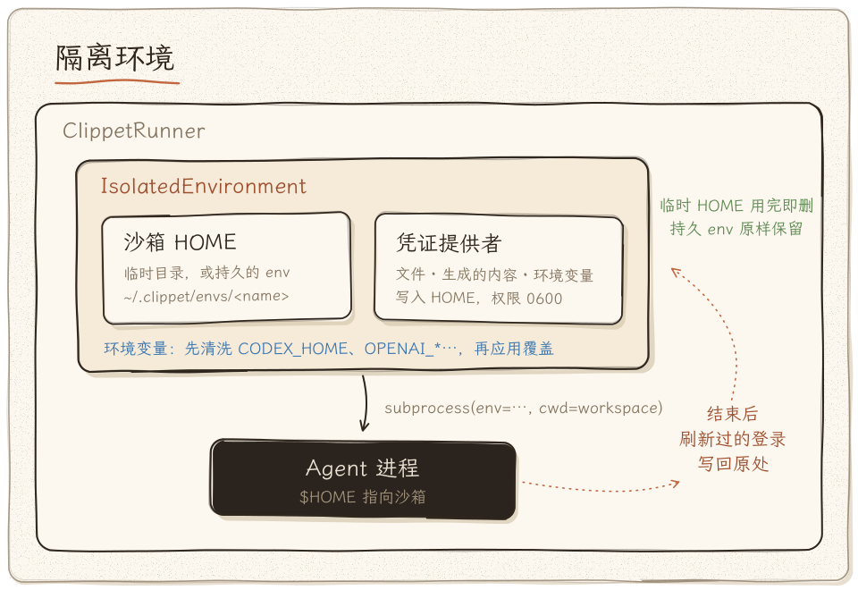

# Isolated Agent Environment Design

> 为 CLIppet 提供凭证隔离与环境沙箱能力，使每个 agent 子进程运行在独立的配置/凭证上下文中，互不干扰。

> **状态**：本文的 P0–P2 均已实现（`clippet/isolation.py`、`clippet/models.py`、`clippet/config/registry.py`）。实现之后的演进见文末「后续演进」。

## 动机

CLI agent 工具（Claude Code、Codex 等）默认读取用户主目录下的配置文件来获取凭证和设置：

| Agent | 凭证/配置路径 |
|-------|---------------|
| Claude Code | `~/.claude/settings.json`, `~/.claude/.credentials.json`, `~/.claude.json` |
| Codex | `~/.codex/auth.json`, `~/.codex/config.toml`（或 `$CODEX_HOME`） |
| QoderCLI | `~/.qoder/`, `~/.qoder-cli/` |

当前 `BaseSubprocessAdapter` 使用 `env=None` 启动子进程，直接继承父进程的全部环境变量和文件系统访问权限。这意味着：

- 所有 agent 共享同一套凭证，无法为不同任务使用不同账户/API key
- 修改凭证会影响正在运行的其他 agent
- 无法在不干扰日常工作流的前提下进行测试或切换

## 设计概览



## 核心模块

### 1. `IsolatedEnvironment` — 隔离环境上下文管理器

- [x] 创建临时沙箱目录作为 agent 的虚拟 `$HOME`
- [x] 支持 context manager 协议（`with IsolatedEnvironment(...) as env:`），退出时自动清理
- [x] 可选持久化模式（不自动清理，用于调试或复用）

```python
class IsolatedEnvironment:
    """为单个 agent 执行创建隔离的文件系统与环境变量上下文。"""

    def __init__(
        self,
        base_dir: Path | None = None,      # 沙箱根目录，默认 tempfile.mkdtemp
        persist: bool = False,              # 是否保留沙箱目录
        inherit_env: bool = True,           # 是否继承父进程环境变量
        env_overrides: dict[str, str] = {}, # 额外环境变量覆盖
        env_whitelist: list[str] | None = None,  # 仅继承这些环境变量
        env_blacklist: list[str] | None = None,  # 排除这些环境变量
    ): ...

    @property
    def home_dir(self) -> Path:
        """沙箱 HOME 路径。"""

    @property
    def env(self) -> dict[str, str]:
        """构建好的环境变量字典，可直接传给 subprocess.Popen(env=...)。"""

    def __enter__(self) -> "IsolatedEnvironment": ...
    def __exit__(self, *exc) -> None: ...
```

### 2. `CredentialProvider` — 凭证注入策略

- [x] 定义统一的凭证提供协议
- [x] 支持多种凭证来源：文件复制、模板渲染、环境变量注入
- [x] 凭证写入沙箱 HOME 的对应路径，而非真实 HOME

```python
class CredentialProvider(Protocol):
    """将凭证写入隔离环境的沙箱目录。"""
    def inject(self, env: IsolatedEnvironment) -> None: ...


class FileCredentialProvider:
    """从指定路径复制凭证文件到沙箱。"""

    def __init__(self, mappings: dict[str, Path]):
        """
        Args:
            mappings: {沙箱内相对路径: 源文件绝对路径}
                例: {".claude/settings.json": Path("/path/to/alt-settings.json")}
        """

    def inject(self, env: IsolatedEnvironment) -> None:
        # 将每个源文件复制到 env.home_dir / relative_path
        ...


class EnvVarCredentialProvider:
    """通过环境变量注入凭证（适用于读取 env 的 agent）。"""

    def __init__(self, variables: dict[str, str]):
        """
        Args:
            variables: {"ANTHROPIC_API_KEY": "sk-xxx", ...}
        """

    def inject(self, env: IsolatedEnvironment) -> None:
        # 将变量合并到 env.env_overrides
        ...


class CredentialSet:
    """组合多个 CredentialProvider，一次性注入。"""

    def __init__(self, providers: list[CredentialProvider]): ...
    def inject(self, env: IsolatedEnvironment) -> None: ...
```

### 3. `AgentRequest` 扩展

- [x] 在 `AgentRequest` 中增加可选的隔离环境配置字段

```python
class AgentRequest(BaseModel):
    task_prompt: str
    workspace_dir: Path = Field(default_factory=Path.cwd)
    timeout: int = 900
    model: str | None = None
    allowed_tools: list[str] | None = None
    extra_args: dict[str, Any] | None = None

    # --- 新增 ---
    isolation: IsolationConfig | None = None  # 为 None 时保持现有行为


class IsolationConfig(BaseModel):
    """隔离环境配置。"""
    credential_files: dict[str, str] = {}    # 沙箱相对路径 -> 源文件路径
    env_overrides: dict[str, str] = {}       # 额外环境变量
    env_whitelist: list[str] | None = None   # 环境变量白名单
    env_blacklist: list[str] | None = None   # 环境变量黑名单
    persist_sandbox: bool = False            # 调试时保留沙箱
```

### 4. `BaseSubprocessAdapter` 改造

- [x] `run()` / `run_async()` 中检测 `request.isolation`，有值时构建 `IsolatedEnvironment`
- [x] 将 `env=None` 替换为 `env=isolated_env.env`
- [x] 确保 `$HOME` 指向沙箱目录

```python
# base.py 中的关键改动（伪代码）
def run(self, request: AgentRequest) -> AgentResult:
    if request.isolation:
        with IsolatedEnvironment(...) as iso:
            for provider in self._build_providers(request.isolation):
                provider.inject(iso)
            return self._execute(request, env=iso.env, home=iso.home_dir)
    else:
        return self._execute(request, env=None, home=None)  # 保持向后兼容
```

### 5. YAML 配置支持

- [x] 支持在配置文件中声明凭证 profile，按名称引用

```yaml
# clippet-config.yaml
credential_profiles:
  personal:
    files:
      ".claude/settings.json": "/Users/me/profiles/personal/claude-settings.json"
      ".claude/.credentials.json": "/Users/me/profiles/personal/claude-creds.json"
    env:
      ANTHROPIC_API_KEY: "${PERSONAL_API_KEY}"

  work:
    files:
      ".claude/settings.json": "/Users/me/profiles/work/claude-settings.json"
    env:
      ANTHROPIC_API_KEY: "${WORK_API_KEY}"

  codex-test:
    files:
      ".codex/auth.json": "/Users/me/profiles/test/codex-auth.json"

adapters:
  - adapter_type: claude
    name: claude-personal
    options:
      credential_profile: personal

  - adapter_type: claude
    name: claude-work
    options:
      credential_profile: work
```

## 典型使用场景

### 场景 A：用不同 API key 并行运行同一 agent

```python
from clippet import ClippetRunner, AgentRequest, IsolationConfig
from clippet.adapters.claude import ClaudeAdapter

runner = ClippetRunner()
runner.register("claude-a", ClaudeAdapter())
runner.register("claude-b", ClaudeAdapter())

results = runner.execute_parallel({
    "claude-a": AgentRequest(
        task_prompt="review this code",
        workspace_dir=Path("./repo"),
        isolation=IsolationConfig(
            env_overrides={"ANTHROPIC_API_KEY": "sk-key-A"},
        ),
    ),
    "claude-b": AgentRequest(
        task_prompt="review this code",
        workspace_dir=Path("./repo"),
        isolation=IsolationConfig(
            env_overrides={"ANTHROPIC_API_KEY": "sk-key-B"},
        ),
    ),
})
```

### 场景 B：替换 Claude Code 的 settings.json 进行测试

```python
request = AgentRequest(
    task_prompt="run the task",
    isolation=IsolationConfig(
        credential_files={
            ".claude/settings.json": "/tmp/test-settings.json",
            ".claude/.credentials.json": "/tmp/test-creds.json",
        },
        persist_sandbox=True,  # 保留沙箱用于事后检查
    ),
)
```

### 场景 C：最小权限环境——仅暴露必要的环境变量

```python
request = AgentRequest(
    task_prompt="analyze code",
    isolation=IsolationConfig(
        env_whitelist=["PATH", "HOME", "ANTHROPIC_API_KEY"],
    ),
)
```

## 实现优先级

1. **P0** — `IsolatedEnvironment` 上下文管理器 + `$HOME` 覆盖
2. **P0** — `FileCredentialProvider`（文件复制方式注入凭证）
3. **P0** — `BaseSubprocessAdapter` 集成（`env` 参数传递）
4. **P1** — `IsolationConfig` 模型 + `AgentRequest` 扩展
5. **P1** — `EnvVarCredentialProvider` + 环境变量白名单/黑名单
6. **P2** — YAML credential profile 配置
7. **P2** — 沙箱清理策略（TTL / 手动 / persist 模式）

## 安全注意事项

- 凭证文件在沙箱中应设置 `0600` 权限
- `persist_sandbox=False` 时，退出 context manager 必须确保沙箱目录被删除（即使出现异常）
- 环境变量中的敏感值不应出现在日志或 `AgentResult.raw_output` 中
- 考虑未来增加 secret masking 能力，在 output parsing 阶段过滤已知的 key pattern

## 后续演进

在本设计落地之后，隔离层又增加了以下能力：

- **持久 HOME 容器**：`IsolationConfig(home_dir=...)` 让 agent 直接以某个持久目录为 `$HOME`（`~/.clippet/envs/<name>/`，由 `clippet env` 管理），会话、登录与历史跨次保留；新建的 env 默认以符号链接共享 `~/.gitconfig` 与 `~/.config/git`。
- **身份环境变量清洗**：`scrub_agent_env=True`（默认）时，从继承的环境中移除会把 agent 重定向到别处的变量，例如 `CODEX_HOME`、`OPENAI_API_KEY`、`ANTHROPIC_*`、`GEMINI_API_KEY`，`home` 范围下还有 `XDG_*_HOME`；之后再应用 `env_overrides`。
- **生成型凭证**：`credential_contents`（`ContentCredentialProvider`）把内存中生成的文件（例如由 Cockpit Tools / sub2api / CLIProxyAPI 账号转换出的 Codex `auth.json`）以 `0600` 原子写入沙箱。
- **刷新回写**：`sync_back`（`CredentialSyncBack`）在运行前记录凭证文件快照，运行结束后若 agent 刷新了 token，就把新文件写回指定位置，避免轮换式 refresh token 随临时 HOME 一起丢失。
- **安全拷贝**：复制目录时跳过 socket、FIFO 等特殊文件；凭证文件统一 `0600`，env 目录 `0700`。

### 隔离范围（isolation scope）：保留真实 HOME

替换 `HOME` 会影响 agent 启动的整棵进程树：Git 的凭据助手、macOS 钥匙串（搜索列表为空，找不到默认钥匙串）、包管理器等都会在 env 目录里找配置。为此 `IsolationConfig` 增加了 `isolation_scope`，并在实现中区分了两个目录：

- **env 根目录**（`IsolatedEnvironment.env_root`）：持久 env 或临时目录。凭据注入、`resolve_path()`、刷新回写和临时目录清理都只以它为根。
- **进程 HOME**（`IsolatedEnvironment.process_home`）：agent 及其子进程看到的 `HOME`。

| 范围 | 进程 `HOME` | agent 的配置与状态 | `XDG_*_HOME` | 适用 |
|------|-------------|--------------------|--------------|------|
| `agent` | 用户真实 HOME | 由 agent 自己的目录变量指向 env，例如 `CODEX_HOME=<env>/.codex` | 保留原值 | 声明了 `AgentSpec.config_dirs` 的 agent（目前是 Codex） |
| `home` | env 根目录 | `<env>/.claude` 等 | 移除 | 其余 agent；也可对任何 env 显式指定 |

- **默认值与兼容**：`isolation_scope=None` 表示 CLIppet 的默认值。对声明了配置目录变量的 agent 取 `agent`，对其余 agent 取 `home`；显式写 `agent` 的效果相同。没有这个字段的旧配置和旧 env 按默认值处理。由于两种范围下 agent 的文件都在 env 的同一位置（Codex 始终是 `<env>/.codex`），切换范围不需要搬迁任何凭据或会话。要恢复旧行为，可以用 `clippet env scope NAME home`（写入 `environments.json` 的 `isolation_scope`），或在 SDK 中用 `IsolationConfig(isolation_scope="home")`，或在组合配置的 credential profile 中写 `"isolation_scope": "home"`。
- **变量优先级**：从继承的环境开始。若当前进程运行在 CLIppet 启动的某次运行里，先把 `HOME` 与 `XDG_*_HOME` 恢复为用户自己的值。然后依次应用白名单、黑名单和身份变量清洗，再应用 `env_overrides`。最后写入由范围管理的变量：`HOME`、`agent` 范围下的配置目录变量，以及 `CLIPPET_HOST_*`。`env_overrides` 不能改写这些变量；`scrub_agent_env=False` 只保留继承的变量，同样不影响它们。
- **嵌套调用**：每次运行都带上 `CLIPPET_HOST_HOME` 和 `CLIPPET_HOST_XDG_*`（即用户自己的值）。在某次运行中再启动的 `clippet` 据此找到真实的注册表（`~/.clippet`），构造下一次运行时也据此恢复用户的 HOME 与 XDG 目录，不会把上一层的 env 目录当成真实 HOME，也不修改父进程的 `os.environ`。`agent` 范围下，agent 启动的工具进程继承 `CODEX_HOME`，所以工具里再启动的 `codex` 仍使用所选 env。前提是 Codex 的 `shell_environment_policy` 没有把它过滤掉，例如 `include_only` 里不含 `CODEX_HOME` 时就会被过滤。
- **Codex 凭据存储**：`agent` 范围下钥匙串可见，因此对 env 中的 Codex 运行总是附加 `-c cli_auth_credentials_store="file"`，让 env 里新做的登录也落在 env 的 `auth.json` 中。这只是单次运行的参数，不修改任何配置文件。即使改用钥匙串，Codex 也按 `CODEX_HOME` 规范路径的哈希区分条目（服务名 `Codex Auth`，账户 `cli|<sha256 前 16 位>`，见 openai/codex 的 `codex-rs/login/src/auth/storage.rs`），各 env 的登录仍然互不覆盖。组织通过托管配置强制的存储方式优先于该参数，CLIppet 不会绕过。
- **统一入口**：交互式 CLI、`codex exec`、同步与异步 adapter、TUI 的无头运行和交互启动都经过 `create_isolated_environment()`，构造结果一致。Codex 桌面 App（`clippet/desktop.py`）本来就保留真实 HOME，只传入同一个 `<env>/.codex` 作为 `CODEX_HOME`。
- **与沙箱权限的区别**：隔离范围只决定配置和凭据在哪里查找；agent 能读写哪些文件、能否联网，仍由 agent 自己的沙箱（例如 Codex 的 `--sandbox`）和操作系统决定，这一改动不改变任何权限策略。
